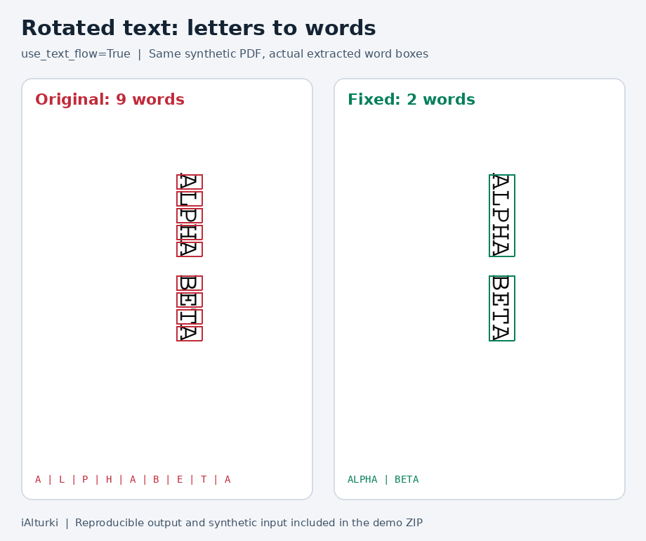

# Rotated-word extraction proof

Demo and fix by [iAlturki](https://github.com/iAlturki).

`page.extract_words(use_text_flow=True)` splits the synthetic clockwise-rotated `ALPHA BETA` into nine single-letter words on the original source. With the fix it returns `ALPHA` and `BETA`. Both report `ttb`; the original used the wrong axis for word boundaries.



[Download the offline interactive demo](rotated-text-flow-demo.zip), unzip it, and open `index.html`. The buttons work without a server or network connection. The ZIP also includes the generated input PDF, actual bounding boxes, capture script, and source commits. The screenshot shows actual extraction results. The demo uses only synthetic text.

Original source: `2fcbe6a6264201e9ae3e661c01c39b4111eb9af0`. Fixed source: `879354af70fe4ce131b3fe0f94a87c55398228d2`.

Validation: Linux, CPython 3.12.3. Original full suite: 173 passed and both new regression tests failed. Fixed full suite: all 175 passed, no skips. Flake8, strict mypy, Black, and isort passed; HTML coverage was generated. Other platforms/Python versions are left to upstream CI.

To repeat the extraction, activate an isolated Python environment. From the unzipped demo directory, clone a fresh checkout of the fix branch and run:

```sh
git clone --branch fix_text_flow_character_direction --single-branch https://github.com/iAlturki/pdfplumber.git pdfplumber
python -m pip install -e ./pdfplumber
git -C ./pdfplumber switch --detach 2fcbe6a6264201e9ae3e661c01c39b4111eb9af0
python demo.py capture --output . --label original --source 2fcbe6a6264201e9ae3e661c01c39b4111eb9af0
git -C ./pdfplumber switch --detach 879354af70fe4ce131b3fe0f94a87c55398228d2
python demo.py capture --output . --label fixed --source 879354af70fe4ce131b3fe0f94a87c55398228d2
```

`demo.py create` can regenerate the synthetic PDF if ReportLab is installed. The bundled input means ReportLab is optional for extraction. The proof is separate from the upstream code/test PR. The repository's MIT license is preserved.

Prepared with AI assistance. Commit author: iAlturki.
